<div align="center">

  <!-- Dynamic Animated Neon Cyan Typing Header -->
  <a href="https://nordixtechnologies.com">
    
  </a>

  <p align="center">
    <strong>Founder & Principal Systems Architect @ Nordix Technologies</strong><br/>
    <em>Specialized in multi-tenant SaaS engineering, high-throughput cloud infrastructure, and defensive financial engines.</em>
  </p>

  <!-- Status & Profile Badges -->
  <p align="center">
    <a href="https://nordixtechnologies.com"></a>
    
    
    
  </p>

</div>

---

### 📊 Enterprise Architecture & System Scope

<div align="center">

| 🏢 Multi-Tenant Core | 📦 Platform Scope | 🛡️ Financial Integrity | 🚀 Deployment |
| :---: | :---: | :---: | :---: |
| **Enterprise SaaS** | **45+ Active Modules** | **100% Zero-Loss** Ledgers | **Git-Driven CI/CD** (EC2) |
| Dynamic tenant isolation | Full ERP, Clinic & Logistics | Double-entry transactional | Automated remote triggers |

</div>

---

### 🖥️ Architect Cockpit

```zsh
┌──[ Dipanjan@nordix-enterprise-core ]──[ ~ ]
└──╼ $ whoami
❯ Dipanjan Saha — Founder & Principal Systems Architect @ Nordix Technologies

┌──[ Dipanjan@nordix-enterprise-core ]──[ ~/architecture-manifest ]
└──╼ $ cat systems_profile.json
{
  "engineering_pillars": [
    "Multi-Tenant SaaS (Dynamic tenant isolation, pooled & dedicated schemas)",
    "Defensive Backend Engineering (Strict transactional bounds, double-entry audit guards)",
    "Automated CI/CD Pipelines (Zero-downtime Git-triggered cloud deployment runners)",
    "Hardware & IoT Ingestion (Biometric push telemetry, POS thermal printing, RFID)"
  ],
  "flagship_platforms": {
    "Multi_School_ERP": "Comprehensive multi-campus management, fee engines, academics & live transit",
    "DocDesk_Health": "Clinical EHR suite with interactive Prescription Studio, OPD/IPD & billing",
    "PharmaOps": "Pharmaceutical logistics, compliance auditing & multi-branch distribution"
  },
  "core_infrastructure": "Laravel 11 • Flutter 3 • AWS EC2/RDS/SES • Nginx • MySQL 8 • Ubuntu Linux"
}
```

---

### 🏛️ High-Level Cloud Architecture Blueprint

```mermaid
flowchart LR
    subgraph Clients["🌐 Client & Device Layer"]
        W["💻 Web Portals<br/>(Admins, Teachers, Staff)"]
        M["📱 Mobile Apps<br/>(Flutter Android/iOS)"]
        IoT["📡 Hardware IoT<br/>(Biometric Push & Thermal)"]
    end

    subgraph Edge["⚡ Edge & Cloud Security"]
        CF["🛡️ Cloudflare<br/>SSL & Anti-DDoS"]
        NG["⚙️ Nginx Reverse Proxy<br/>HTTP/2 & Rate Limiter"]
    end

    subgraph Core["🚀 Enterprise Core (Laravel 11)"]
        TR["🔀 Multi-Tenant Router<br/>Subdomains & Custom Domains"]
        SVC["⚙️ Domain Services<br/>Auditing, FeesModule, Transit"]
        CD["🔁 GitHub Actions<br/>Zero-Downtime Deployment Runner"]
    end

    subgraph Storage["💾 Persistence & State Tier"]
        DB[("🗄️ MySQL 8<br/>Multi-Tenant Relational Data")]
        RD[("⚡ Redis<br/>Cache, Queues & Sessions")]
        S3[("☁️ AWS S3 / SES<br/>Signed Docs & Cloud Mail")]
    end

    Clients --> Edge
    Edge --> Core
    Core --> Storage
```



---

### 🚀 Flagship Systems & Platforms

<table>
  <tr>
    <td width="50%" valign="top">
      <h3>🏫 Nordix Multi-School ERP</h3>
      <p><em>Enterprise Multi-Campus Administration & Academic Engine</em></p>
      <ul>
        <li><strong>Architecture:</strong> Single-codebase multi-tenancy with dynamic tenant isolation.</li>
        <li><strong>Financial Engine:</strong> Double-entry fee accounting, rapid entry, receipts & discount management.</li>
        <li><strong>Academics & NEP 2020:</strong> Holistic Progress Card (HPC), report cards, exams & attendance lock.</li>
        <li><strong>Transit & Fleet:</strong> Route mapping, vehicle capacity guards, stop reassignment & GPS feeds.</li>
      </ul>
      <p>
        
        
        
        
      </p>
    </td>
    <td width="50%" valign="top">
      <h3>🩺 DocDesk Healthcare Suite</h3>
      <p><em>Clinical Practice Management & Electronic Health Records (EHR)</em></p>
      <ul>
        <li><strong>Prescription Studio:</strong> Interactive drug-drug interaction checker & auto-dispense suggestions.</li>
        <li><strong>Clinical Workflows:</strong> OPD triage, appointment queues, doctor consult desks & dental charts.</li>
        <li><strong>Diagnostic Lab:</strong> Custom investigation templates, barcode labeling & PDF report exports.</li>
        <li><strong>Billing & Pharmacy:</strong> Integrated medicine inventories, GST invoicing & ledger settlement.</li>
      </ul>
      <p>
        
        
        
        
      </p>
    </td>
  </tr>
  <tr>
    <td width="50%" valign="top">
      <h3>💊 PharmaOps Logistics Core</h3>
      <p><em>Pharmaceutical Logistics & Multi-Warehouse Supply Chain</em></p>
      <ul>
        <li><strong>Batch & Expiry Control:</strong> Real-time FIFO/FEFO stock tracking with automated expiry alerts.</li>
        <li><strong>Compliance & Audit:</strong> Schedule H/H1 regulatory registers, tax compliance & batch tracing.</li>
        <li><strong>Multi-Branch Ingestion:</strong> Centralized distributor hub feeding local pharmacy endpoints.</li>
      </ul>
      <p>
        
        
        
      </p>
    </td>
    <td width="50%" valign="top">
      <h3>📡 Hardware & IoT Telemetry Hub</h3>
      <p><em>Biometric Machine Push SDK & Hardware Device Ingestion</em></p>
      <ul>
        <li><strong>Biometric Telemetry:</strong> High-throughput device webhook receiver with anti-flood DoS defense.</li>
        <li><strong>Thermal Network Printing:</strong> ESC/POS network driver generation for instant cash counter receipts.</li>
        <li><strong>RFID & Smart Cards:</strong> Student bus tap-in tracking and automated SMS alert dispatches.</li>
      </ul>
      <p>
        
        
        
      </p>
    </td>
  </tr>
</table>

---

### ⚡ Full-Spectrum Technical Arsenal

<div align="center">

  <p align="center">
    <strong>Languages & Core Runtimes</strong><br/>
    <a href="https://skillicons.dev">
      
    </a>
  </p>

  <p align="center">
    <strong>Mobile & Front-End Engineering</strong><br/>
    <a href="https://skillicons.dev">
      
    </a>
  </p>

  <p align="center">
    <strong>Cloud Infrastructure, DevOps & Tooling</strong><br/>
    <a href="https://skillicons.dev">
      
    </a>
  </p>

  <p align="center">
    <strong>Persistence, Caching & Distributed Version Control</strong><br/>
    <a href="https://skillicons.dev">
      
    </a>
  </p>

</div>

---

### 🛠️ Architecture Deep-Dive

<details>
  <summary><strong>🔍 Click to expand: Multi-Tenant Database & Domain Strategy</strong></summary>
  <br/>
  
  * **Dynamic Domain Dispatch:** Custom subdomains (e.g. `school-a.nordixtechnologies.com`) and custom white-label domains automatically resolve via middleware without manual virtual hosts.
  * **Tenant Scoping:** Scoped database architecture ensuring zero cross-tenant data bleed, paired with separate administrative audit logs.
  * **Session Isolation:** Multi-guard authentication separating superadmins, institutional admins, doctors/teachers, and parents/patients.
</details>

<details>
  <summary><strong>🔍 Click to expand: Defensive Financial Engineering & Auditing</strong></summary>
  <br/>
  
  * **Double-Entry Ledgers:** Every fee payment or clinical invoice writes both debit and credit entries with immutable receipt identifiers.
  * **Strict State Machines:** Transitions (e.g. *Pending → Partial → Cleared → Voided*) guarded against race conditions and tamper requests.
  * **Operator Concessions:** Fee discounts and payment reversals require mandatory recorded reasons, operator user IDs, and explicit authorization.
</details>

<details>
  <summary><strong>🔍 Click to expand: Automated Cloud CI/CD & Deployment Hardening</strong></summary>
  <br/>
  
  * **Branch PR Protocol:** Direct server pushes strictly blocked. Every change merges through feature branches and Pull Requests.
  * **Automated Runner Pipeline:** GitHub Actions communicates over SSH with dedicated Deploy Keys, executing zero-downtime database migrations, opcode cache invalidation, and PHP-FPM process reloads.
  * **Immutable Backups:** Automated daily database dumps and configuration state preservation.
</details>

---

### 📬 Connect & Enterprise Inquiries

<div align="center">

  <a href="https://nordixtechnologies.com"></a>
  &nbsp;
  <a href="mailto:dipanjan.saha@nordixtechnologies.com"></a>
  &nbsp;
  <a href="https://github.com/deep140998"></a>

  <br/><br/>
  <sub>© Nordix Technologies • Engineered with precision • Built for enterprise-grade scalability</sub>

</div>
